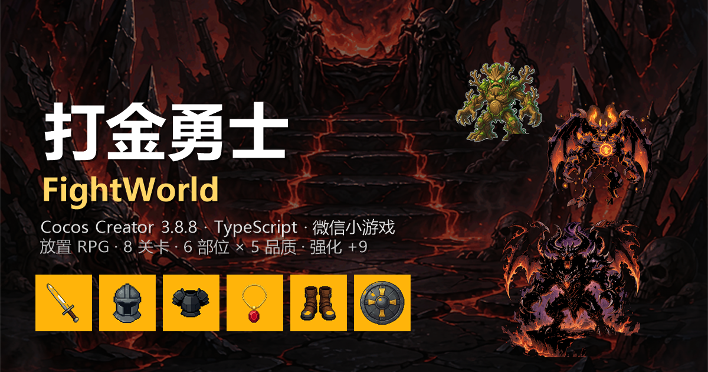
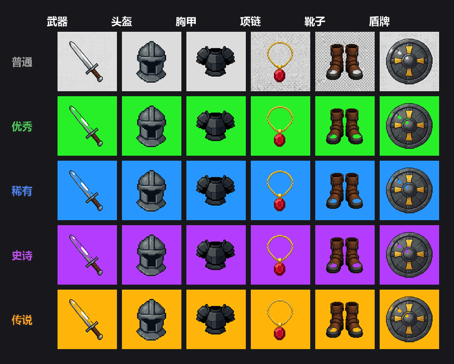
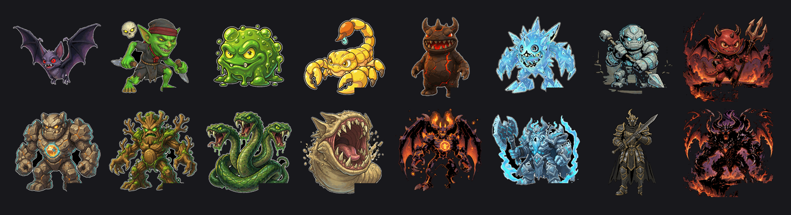

<div align="center">

# 打金勇士 · FightWorld

**一款竖屏放置 RPG 微信小游戏 —— 刷装备、强化、推关，越打越强**

Cocos Creator 3.8.8 · TypeScript · 微信小游戏

[🎮 在线试玩](https://yujue1234.github.io/FightWorld/) · [核心系统](#-核心系统) · [数值设计](#-数值设计)

</div>



---

## 📖 项目简介

《打金勇士》是一款单人竖屏放置 RPG。玩家在 8 个关卡中刷怪、掉落装备、强化属性，逐步挑战更强的 Boss。

项目最初是为了验证一个问题：**当数值是拍脑袋定的，游戏会在什么地方卡住？**
于是我把整场战斗用 Python 逐帧复现了一遍，反推关卡数值，再回到 TypeScript 实现——
这个仓库里既有可玩的游戏，也有一套可复现的数值验证脚本。


- **引擎**：Cocos Creator 3.8.8（2D）
- **语言**：TypeScript（严格类型，全量 `tsc` 检查 0 错误）
- **目标平台**：微信小游戏（同时可导出 Web 试玩）
- **设计分辨率**：720 × 1280 竖屏

---

## 🎮 核心玩法

1. **选关** → 自动回合制战斗（3 小怪 + 1 Boss）
2. **掉落装备** → 6 个部位、5 种品质，品质越高越强
3. **穿戴 / 替换** → 实时汇总属性到顶部状态栏
4. **强化** → +1 ~ +9，每级 +15%，有失败概率
5. **推关** → 通关后解锁下一关，怪物强度阶梯上升

没有手动操作，战斗是自动进行的——策略全部体现在**养成决策**上：这一千金币该买装备，还是去强化？

---

## ⚙️ 核心系统

### 装备系统

| 部位 | 定位 | 主要属性 |
|---|---|---|
| 武器 | 输出 | 攻击、暴击率 |
| 项链 | 输出/收益 | 攻击、暴击率、暴击伤害、幸运 |
| 头盔 | 生存 | 防御、生命 |
| 胸甲 | 生存 | 防御、生命 |
| 盾牌 | 生存 | 防御、生命 |
| 靴子 | 收益 | 防御、生命、幸运 |

- **品质倍率**：普通 1.0 / 优秀 1.5 / 稀有 2.1 / 史诗 2.9 / 传说 4.0
- **属性计算**：`最终属性 = 部位基础值 × 品质倍率 × (1 + 强化等级 × 0.15)`
- **暴击率做了 1.0 上限兜底**——暴击同时吃品质和强化两个乘数，不加限制会溢出



### 背包

- 初始 **5 列 × 4 排 = 20 格**，可花金币扩排（每排 +5 格）
- 6 个装备槽与背包分离；容量满时商店购买会拦截并退款
- 全新账号开局直接穿戴 6 件普通装备，保证不会卡在第一步

### 强化

| 项 | 规则 |
|---|---|
| 等级上限 | +9 |
| 单级收益 | 装备属性 +15% |
| 费用 | `150 × (当前等级 + 1)` 金币 |
| 成功率 | 100% → 95% → 90% → … → 40%（逐级下降） |
| 单件 +9 期望 | 约 13,887 金币 |

强化等级在背包、强化页、详情弹窗中统一以**红色 `+N`** 展示。

### 商店

- **6 个格子**，每次刷新重新生成商品
- 刷新费用：**5 元宝**
- 双货币：普通~史诗装备用金币购买；**传说装备仅商店刷新产出，固定 50 元宝**
- 价格随装备实际战力折算，避免"高品阶垃圾比低品阶神装还贵"

### 关卡与解锁

8 个关卡：矿洞入口 → 迷雾沼泽 → 骸骨荒原 → 熔岩裂谷 → 幽暗森林 → 霜冻废墟 → 天空遗迹 → 深渊魔域

- **必须通关上一关才能解锁下一关**，规则集中定义在 `PlayerData.isStageUnlocked()` 一处
- 未解锁关卡显示半透明遮罩 + 提示，仍可左右翻看（保留目标感）
- 解锁进度跟随存档持久化，退出重进不丢



### 存档

- 微信小游戏本地存储，Key：`fightworld_save_v1`
- 保存：金币、元宝、背包、已穿戴装备、已通关关卡
- 兼容旧档：无存档时才发放新手装备，老玩家不会被覆盖

---

## 📐 数值设计

这是项目里最花心思的部分。**所有数值都是模拟验证过的，不是拍脑袋定的。**

### 战斗公式

```
玩家每击伤害 = 攻击 × (1 + 暴击率 × (暴击伤害 - 1))     ← 等价期望值，无随机
怪物每击伤害 = 怪物攻击 × 100 / (100 + 玩家防御)          ← 防御收益递减
```

- 玩家攻击间隔 1.0s，怪物攻击间隔 1.5s，玩家先手
- 每关 3 只小怪 + 1 只 Boss，Boss 血量约小怪的 2.6 倍、攻击约 1.8 倍

### 核心约束

> **玩家血量 ≈ 怪物单次攻击的 15~20 倍**

一场战斗大约 30~45 秒，玩家会挨 20~30 次攻击。
低于这个倍数，玩家会被秒；高于这个倍数，战斗会变得没有压力。

### 八个装备档位 → 八个关卡

| 装备档位 | 对应关卡 | 关后剩余血量 |
|---|---|---|
| 裸装 | 第 1 关 | 约 30% |
| 6 件普通 | 第 2 关 | 21~30% |
| 6 件优秀 | 第 3 关 | 21~30% |
| 6 件稀有 | 第 4 关 | 21~30% |
| 6 件史诗 | 第 5 关 | 21~30% |
| 6 件史诗 +3 | 第 6 关 | 21~30% |
| 6 件史诗 +6 | 第 7 关 | 21~30% |
| 6 件史诗 +9 | 第 8 关 | 21~30% |

**每一关都满足：本档装备可通关，上一档必败。** 这才叫"阶段性变强"。

### 防卡死设计

早期版本存在死局：打不过怪 → 赚不到金币 → 买不起装备 → 永远打不过。

现在有三重兜底：

1. 开局白送 6 件普通装备（直接穿戴）
2. 战斗失败仍发放关卡奖励 25% 的金币（下限 50）
3. 第 1 关的强度按"裸装可过"设计，即使装备全丢也能重新起步

### 验证方式

`balance/` 目录下是一套 Python 脚本，**逐帧复现战斗逻辑**：

| 脚本 | 作用 |
|---|---|
| `sim.py` | 战斗模拟器（按 5ms 步长推进，复现攻击间隔/波次/伤害公式） |
| `tune.py` / `tune2.py` | 关卡数值反解：给定目标档位，倒推怪物血量与攻击 |
| `econ.py` / `econ2.py` | 经济模型：装备定价、强化期望花费、每档需要刷几把 |
| `verify.py` / `verify2.py` / `verify3.py` | 回归验证：8 档位映射、关卡解锁链、防卡死 |
| `compare.py` | 改前 / 改后数值对照 |

最终结果：8 个档位精确对应 8 个关卡，经济节奏为每档 2~6 把，全部通过回归验证。

---

## 🏗️ 技术架构

### 单场景多页

整个游戏只有 **1 个 Scene**，靠 `PageManager` 切换两组节点的显隐：

```
backgroundList[i] / contentList[i]  →  0 主页  1 背包  2 强化  3 商店  4 成就  5 战斗
```

好处是切页无加载、状态天然保留；代价是需要在 `onEnable` 里主动刷新数据（例如通关回主页时刷新地图解锁状态）。

### 数据与表现分离

- `EquipData` —— 单件装备的纯数据与属性计算
- `PlayerData` —— 玩家全局状态（金币/元宝/通关记录/解锁判定）
- `SaveManager` —— 序列化与本地存储
- 各 `Manager` —— 只负责节点与交互，不持有业务数值

这样调数值只需要改 4 个地方：`EquipData.BASE_STATS`、`EquipData.QUALITY_MULTIPLIER`、`StageData.STAGES`、`ShopManager.QUALITY_PRICE_MULT`。

### 一些工程细节

- 全量 `tsc` 类型检查（`strict` 关闭但类型完整），当前 **0 错误**
- 所有按钮事件在 `onDestroy` 中显式解绑，避免页面重进后重复触发
- `BagManager.instance` 单例在销毁时置空，防止拿到已销毁组件
- 未解锁关卡的遮罩/提示节点若未在编辑器绑定，会由代码自动生成

---

## 📁 目录结构

```
FightWorld/
├── assets/
│   ├── Scene/                 # 主场景
│   ├── Script/                # 全部 TypeScript 逻辑（17 个脚本）
│   │   ├── EquipData.ts       # 装备数据与属性计算
│   │   ├── PlayerData.ts      # 玩家全局数据 / 关卡解锁判定
│   │   ├── StageData.ts       # 关卡配置 / 掉落 / 幸运判定
│   │   ├── BattleManager.ts   # 自动战斗
│   │   ├── BagManager.ts      # 背包
│   │   ├── ForgeManager.ts    # 强化
│   │   ├── ShopManager.ts     # 商店
│   │   ├── MapManager.ts      # 地图与关卡选择
│   │   ├── SaveManager.ts     # 存档
│   │   └── ...
│   ├── Prafabs/               # 预制体
│   └── resources/             # 图标 / 背景 / 怪物 / 关卡图
├── balance/                   # 数值模拟与验证脚本（Python）
├── docs/                      # GitHub Pages 站点（Web 试玩版构建产物 + 文档）
│   └── images/                # README 用图
├── settings/                  # Cocos 工程配置
└── package.json
```

> 说明：`library/`、`temp/`、`build/` 为 Cocos 生成物，已在 `.gitignore` 中排除。

---

## 🚀 本地运行

### 方式一：直接玩 Web 版

访问 [在线试玩](https://yujue1234.github.io/FightWorld/)，无需安装。

### 方式二：用 Cocos Creator 打开

1. 安装 **Cocos Creator 3.8.8**
2. 打开 Cocos Dashboard → 添加项目 → 选择本仓库根目录
3. 打开 `assets/Scene` 下的主场景，点击运行

### 方式三：命令行构建 Web 版

```bash
# Windows（注意：若终端里存在 ELECTRON_RUN_AS_NODE=1，需要先移除）
"CocosCreator.exe" --project "<本仓库路径>" --build "platform=web-mobile;debug=false"
```

构建产物在 `build/web-mobile/`，用任意静态服务器打开即可。

---

## 📝 说明

- 美术素材由 AI 生成 + 后期处理，仅用于个人作品展示
- 数值脚本与游戏逻辑保持同步：改数值 → 跑 `balance/verify*.py` → 再提交
- 项目仍在迭代中，成就系统为下一步计划
